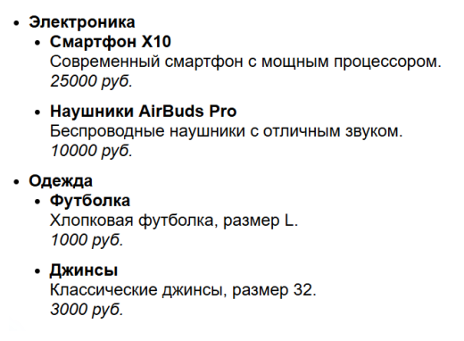

# Лабораторная работа 1

## Задание

Вариант 9

Создать каталог товаров, сгруппированных по категориям. Категории и товары
должны быть представлены в виде списка. Внутри каждой категории должен
находиться список товаров, относящихся к данной категории. Каждый товар должен
содержать название, выделенное жирным шрифтом, краткое описание и цену,
выделенную курсивом. Пример отображения каталога изображен на иллюстрации:

## Реализация

Страница состоит из заголовка с указанием лабораторной работы и каталога
товаров.

Каталог товаров выполнен в виде ненумерованного списка, подпунктами которого
являются вложенные ненумерованные списки. Каждый пункт каталога содержит
категорию товаров, каждая категория товаров содержит список товаров данной
категории.

CSS-решения:

- Категории и названия товаров должны быть выделены жирным шрифтом: для
  селектора `li` свойство `font-weight: bold`;
- Иконки у списков и вложенных списков одинаковы: для селектора `li` свойство
  `list-style-type: disc`;
- Цена каждого товара должны быть выделена курсивом: для блоков текста с ценой
  установлен класс `price`, для класса `.price` свойство `font-style: italic`.

## Запуск

Откройте `index.html` в браузере.
